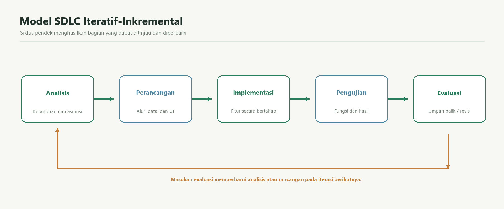

# Analisis dan rancangan sistem

## Status fakta dan asumsi

Judul dan fokus mengikuti rencana proyek mahasiswa. Nama usaha dan hasil observasi/wawancara belum diberikan, sehingga uraian masalah lapangan di bawah merupakan **asumsi perancangan**. Tidak ada kunjungan atau wawancara yang diklaim telah dilakukan. Judul tetap perlu dikonfirmasi kepada dosen sesuai ketentuan UTS.

## Project charter

| Unsur | Isi |
|---|---|
| Masalah yang dituju | Pencatatan penjualan dan pengeluaran UMKM kecil berpotensi tersebar atau dilakukan manual sehingga rekap omzet dan biaya memerlukan pekerjaan tambahan. Kondisi objek nyata belum diverifikasi. |
| Tujuan | Membuat prototipe web untuk menyimpan transaksi penjualan dan biaya serta menyajikan ringkasan berdasarkan data yang dicatat. |
| Pengguna | Pemilik dan operator/kasir UMKM. Mahasiswa bertindak sebagai analis dan pengembang; dosen sebagai evaluator. |
| Ruang lingkup | Login, ringkasan, CRUD penjualan satu deskripsi per transaksi, CRUD pengeluaran, laporan tanggal harian/bulanan, cetak/CSV, dan struktur MySQL. |
| Di luar ruang lingkup | Persediaan/HPP, e-commerce, pembayaran, pajak, multi-cabang, akuntansi penuh, dan integrasi bank. |
| Risiko | Kebutuhan kasus belum divalidasi; runtime PHP Vercel bersifat community runtime; database produksi belum tersedia; kualitas data uji tidak mewakili operasi nyata. |
| Luaran | Source PHP, skema SQL, ERD, context diagram, analisis, laporan pada template asli, bukti pengujian, Git, dan rencana deployment. |

## Model SDLC

Model iteratif-inkremental dipilih karena: (1) fitur dapat dibagi menjadi login, penjualan, pengeluaran, dan laporan; (2) setiap bagian dapat ditinjau setelah implementasi; (3) asumsi kebutuhan dapat diperbarui setelah objek UMKM dikonfirmasi; dan (4) kesalahan rumus dapat ditemukan sebelum fitur berikutnya dikembangkan. Siklusnya adalah analisis, perancangan, implementasi, pengujian, lalu evaluasi dan iterasi.

## Stakeholder

| Peran | Kebutuhan/tugas utama |
|---|---|
| Pemilik UMKM | Mencatat/meninjau penjualan dan pengeluaran serta melihat ringkasan sederhana. (Asumsi, perlu validasi.) |
| Operator/kasir | Memasukkan transaksi dengan cepat dan mengoreksi kesalahan pencatatan. (Asumsi, perlu validasi.) |
| Mahasiswa/pengembang | Menerjemahkan kebutuhan, membuat dan memeriksa aplikasi, serta menyusun dokumentasi. |
| Dosen/evaluator | Memeriksa konsistensi proses RPL, rancangan, bukti Git, dan hasil UTS. |

## Elicitation

Belum ada wawancara. Seluruh jawaban berikut merupakan asumsi untuk disampaikan sebagai pertanyaan kepada calon pengguna.

| No. | Pertanyaan | Asumsi yang perlu dikonfirmasi |
|---:|---|---|
| 1 | Bagaimana penjualan dicatat saat ini? | Mungkin memakai buku atau catatan telepon. |
| 2 | Informasi apa yang wajib dicatat pada setiap penjualan? | Tanggal, deskripsi barang/layanan, jumlah, dan harga satuan. |
| 3 | Apakah satu nota dapat memuat banyak jenis barang? | Prototipe membatasi satu deskripsi barang/layanan per transaksi; perlu konfirmasi. |
| 4 | Biaya usaha apa yang ingin dicatat? | Nominal, kategori, tanggal, deskripsi, dan keterangan. |
| 5 | Laporan periode apa yang paling dibutuhkan? | Harian dan bulanan. |
| 6 | Siapa saja yang boleh menggunakan aplikasi? | Pemilik atau operator yang dibuatkan akun. |
| 7 | Apakah data perlu dicetak atau dibagikan? | Cetak dan CSV mungkin membantu rekap; perlu konfirmasi. |
| 8 | Unsur apa yang harus masuk perhitungan laba? | Prototipe menghitung penjualan dikurangi pengeluaran tercatat; HPP/pajak tidak dimodelkan. |

## Kebutuhan fungsional

| Kode | Kebutuhan | Prioritas |
|---|---|---|
| FR-01 | Sistem mengautentikasi pengguna dengan username dan password yang tersimpan sebagai hash. | Must |
| FR-02 | Pengguna dapat melihat ringkasan penjualan, pengeluaran, laba sederhana, jumlah transaksi, dan aktivitas harian/bulanan. | Must |
| FR-03 | Pengguna dapat menambah, melihat, mengubah, dan menghapus catatan penjualan. | Must |
| FR-04 | Pengguna dapat menambah, melihat, mengubah, dan menghapus catatan pengeluaran. | Must |
| FR-05 | Sistem menyaring laporan menurut tanggal awal dan akhir, termasuk kedua tanggal. | Must |
| FR-06 | Sistem menampilkan ringkasan laporan harian dan bulanan dengan laba sederhana. | Must |
| FR-07 | Pengguna dapat mencetak laporan dan mengunduh rincian sebagai CSV. | Should |
| FR-08 | Sistem membatasi pembacaan dan perubahan catatan ke pengguna yang sedang login. | Must |

## Kebutuhan nonfungsional dan pemeriksaan

| Kode | Ukuran mutu/batasan | Pemeriksaan |
|---|---|---|
| NFR-01 | Target respons halaman ringkasan dan laporan kurang dari 2 detik pada koneksi localhost dengan data uji. | Diukur dengan 10 permintaan lokal per halaman setelah autentikasi; angka aktual dan metode dicatat pada status implementasi. Hasil ini bukan pengukuran hosting publik. |
| NFR-02 | Password disimpan dengan `password_hash`; cookie autentikasi `HttpOnly`, `SameSite=Lax`, dan `Secure` pada HTTPS. | Periksa kolom hash dan atribut cookie pada respons login. |
| NFR-03 | Semua mutasi data memvalidasi tipe/batas nilai di server, memakai prepared statements, dan token CSRF. | Tinjau source dan jalankan permintaan valid/tidak valid serta permintaan tanpa token. |
| NFR-04 | Antarmuka menjaga navigasi dan tabel dapat digunakan pada lebar desktop dan ponsel (breakpoint 680 px). | Periksa layout pada viewport desktop dan 390 px; pemeriksaan ponsel masih perlu dilakukan. |

## Kriteria penerimaan

| Kode | Kondisi | Hasil yang dapat diperiksa |
|---|---|---|
| AC-01 | Empat penjualan simulasi berjumlah Rp174.000 dan tiga pengeluaran simulasi berjumlah Rp49.000. | Dashboard dan laporan menunjukkan laba sederhana Rp125.000. |
| AC-02 | Ditambah 2 unit dengan harga Rp12.000, lalu harga diperbarui menjadi Rp13.000. | Subtotal berubah dari Rp24.000 menjadi Rp26.000; laporan setelah catatan uji kedua ditambahkan menunjukkan Rp200.000 penjualan, Rp53.000 pengeluaran, dan Rp147.000 laba. |
| AC-03 | Pengguna mengisi kuantitas atau nominal tidak positif. | Validasi browser dan server menolak nilai; database tidak menerima catatan tersebut. |
| AC-04 | Laporan difilter 1-21 Oktober 2026. | Hanya transaksi pada rentang inklusif tersebut yang masuk jumlah laporan. |
| AC-05 | Pengguna lain meminta catatan milik akun berbeda. | Query aplikasi tidak mengembalikan data tersebut karena semua operasi dibatasi oleh `user_id`. |

## Rumus keuangan

Subtotal = kuantitas × harga satuan. Total penjualan = jumlah subtotal pada periode. Total pengeluaran = jumlah nominal biaya pada periode. Laba operasional sederhana = total penjualan − total pengeluaran. Semua nilai uang menggunakan `DECIMAL`; subtotal dihitung sebagai kolom generated MySQL dan agregasi dihitung di database. Perhitungan bukan laba akuntansi penuh karena HPP, pajak, persediaan, piutang, dan penyusutan belum dimodelkan.

## Context diagram dan proses bisnis

## Basis data

Skema aktual di `database/schema.sql` terdiri dari tiga tabel: `users`, `sales`, dan `expenses`. Kolom `sales.subtotal` adalah kolom generated, bukan nilai yang dimasukkan pengguna. Indeks `(user_id, date)` membantu filter laporan. Semua tabel memakai InnoDB, dan kunci asing ke pengguna memakai `ON DELETE CASCADE`.

| Tabel | PK | FK | Fungsi |
|---|---|---|---|
| users | id | - | Akun, hash password, dan versi pencabutan sesi. |
| sales | id | user_id → users.id | Catatan penjualan satu deskripsi barang/layanan. |
| expenses | id | user_id → users.id | Catatan biaya usaha. |

| Relasi | Kardinalitas | Makna |
|---|---|---|
| users–sales | 1:N | Satu akun memiliki nol atau lebih penjualan. |
| users–expenses | 1:N | Satu akun memiliki nol atau lebih pengeluaran. |

## Kamus data

| Tabel | Atribut | Tipe | Keterangan |
|---|---|---|---|
| users | id | BIGINT UNSIGNED | PK, auto increment. |
| users | name | VARCHAR(100) | Nama tampilan, wajib. |
| users | username | VARCHAR(50) | Nama login unik, wajib. |
| users | password_hash | VARCHAR(255) | Hash dari `password_hash`; tidak menyimpan password asli. |
| users | auth_version | INT UNSIGNED | Versi pencabutan cookie saat logout, default 0. |
| users | created_at | TIMESTAMP | Waktu pembuatan akun, default saat ini. |
| sales | id | BIGINT UNSIGNED | PK, auto increment. |
| sales | user_id | BIGINT UNSIGNED | FK ke users.id, wajib. |
| sales | invoice_no | VARCHAR(32) | Nomor transaksi unik. |
| sales | sale_date | DATE | Tanggal penjualan, wajib. |
| sales | description | VARCHAR(160) | Nama barang/layanan, wajib. |
| sales | quantity | INT UNSIGNED | Jumlah unit positif. |
| sales | unit_price | DECIMAL(15,2) | Harga satuan Rupiah, nilai uang eksak. |
| sales | subtotal | DECIMAL(18,2) | Generated dari quantity × unit_price. |
| sales | created_at | TIMESTAMP | Waktu pencatatan. |
| sales | updated_at | TIMESTAMP | Waktu perubahan terakhir. |
| expenses | id | BIGINT UNSIGNED | PK, auto increment. |
| expenses | user_id | BIGINT UNSIGNED | FK ke users.id, wajib. |
| expenses | expense_date | DATE | Tanggal pengeluaran, wajib. |
| expenses | category | VARCHAR(80) | Kategori biaya, wajib. |
| expenses | description | VARCHAR(160) | Deskripsi biaya, wajib. |
| expenses | amount | DECIMAL(15,2) | Nominal positif, nilai uang eksak. |
| expenses | notes | TEXT NULL | Keterangan tambahan opsional. |
| expenses | created_at | TIMESTAMP | Waktu pencatatan. |
| expenses | updated_at | TIMESTAMP | Waktu perubahan terakhir. |

## Status implementasi lokal

- PHP 8.2.12, MariaDB 10.4.32, PDO MySQL, dan data simulasi berjalan lokal. Sepuluh permintaan terautentikasi per halaman pada `127.0.0.1` menghasilkan respons HTTP 200; waktu minimum/rata-rata/maksimum ringkasan 10/21/98 ms dan laporan 10/13/16 ms. Pengukuran memakai `Invoke-WebRequest` dari mesin pengembang, sehingga tidak mewakili browser/perangkat lain atau hosting publik.
- Uji browser mencakup login/logout, penambahan/perubahan penjualan dan pengeluaran, filter laporan, serta kecocokan agregat. Hapus penjualan dan pengeluaran diperiksa melalui permintaan POST lokal terotorisasi; dialog konfirmasi visual tidak dihitung sebagai pengujian.
- Uji viewport ponsel, observasi/wawancara, repo GitHub baru, PR, hosting publik, dan database produksi masih belum tersedia.
